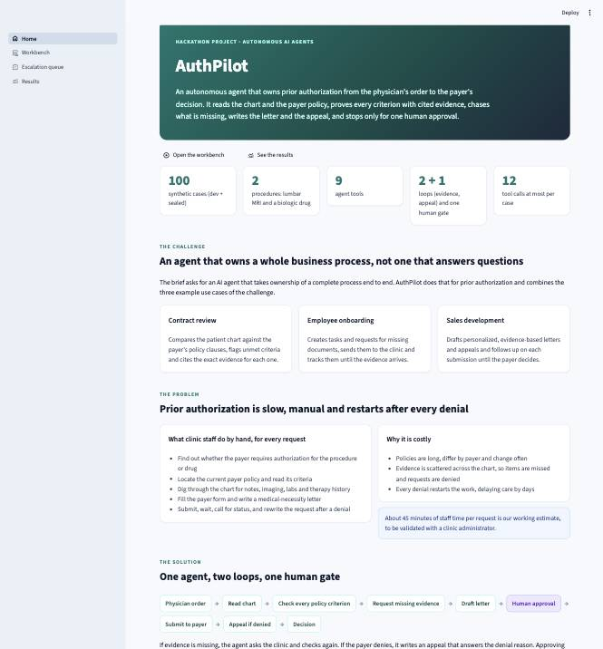
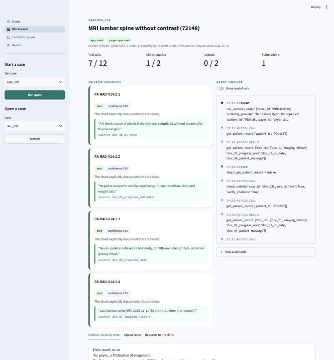
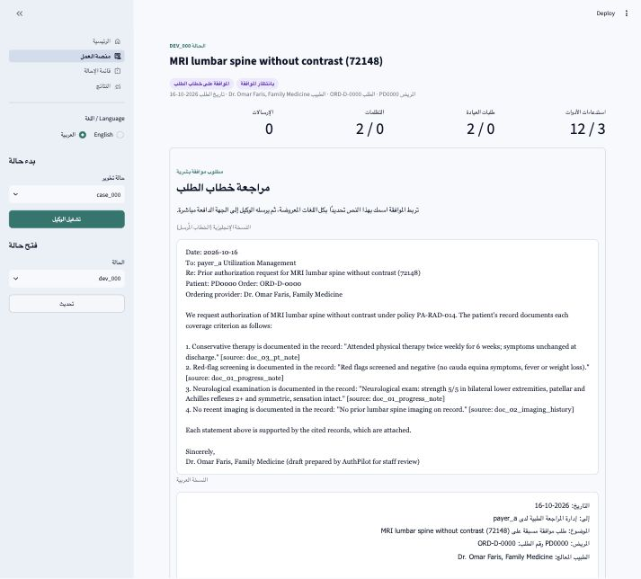
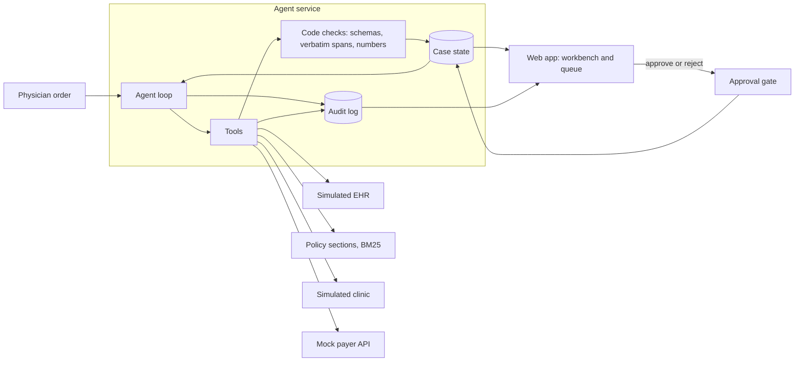
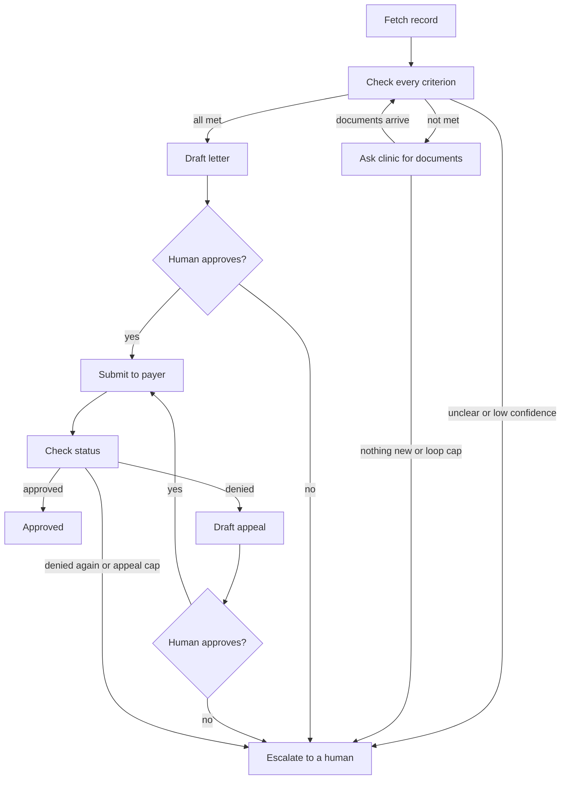

# AuthPilot

An autonomous prior authorization agent. It takes a physician's order, reads a synthetic patient
chart and the payer's policy, decides whether each policy criterion is met with cited evidence,
requests missing evidence from the clinic, drafts a medical-necessity letter, waits for a human
to approve it, submits it to a (mock) payer, and drafts an appeal if the request is denied.

All patient data in this repository is synthetic. No real patient data is used anywhere.

- Pitch deck (open in a browser, arrow keys to move): [docs/slides.html](docs/slides.html)
- Five-minute demo script with fallbacks and Q&A: [docs/DEMO_SCRIPT.md](docs/DEMO_SCRIPT.md)
- Backup storyboard of the demo (screenshots of every step): [docs/demo_backup/README.md](docs/demo_backup/README.md)
- One-page results summary for the slides: [docs/results_summary.md](docs/results_summary.md)
- Work log, decisions, known limits and the remaining plan: [docs/PROGRESS.md](docs/PROGRESS.md)
- Original spec: [authpilot_cursor_prompt.md](authpilot_cursor_prompt.md)

## Status

| Phase | Scope | State |
| --- | --- | --- |
| 0 | Scaffolding, schemas, audit log, policies, seeded data generator | Done |
| 1 | LLM wrapper with live, replay and stub modes, policy search, criteria checking, first metrics | Done |
| 2 | Gap loop, letter, mock payer, submission, agent loop, CLI | Done |
| 3 | Human approval gate, appeal loop, fallbacks with fault-injection tests | Done |
| 4 | Web app: landing page, workbench, escalation queue, results (multi-page Streamlit, custom theme) | Done |
| 5 | Full evaluation: baselines, ablations, perturbations, unseen procedure, fault injection, coverage curve, regression check | Done (dev split, stub model) |
| 6 | Packaging: locked dependencies, Dockerfile, clean-clone check, final README, one-page results summary | Done |
| 7 | Demo and buffer: demo script, slide deck, backup storyboard, bug sweep | Done |
| Stretch | Arabic: bilingual letters (English and Arabic) and an Arabic, right-to-left web app | Done |
| Next | Full live evaluation on dev, then the sealed test split once; record the demo video | Needs you |

The offline suite passes. `make test`, `make demo` and `make dashboard` run without an API key
(the demo and the dashboard use the stub when `cache/llm_cache.jsonl` is absent). `make eval`
refuses stub mode: it needs `LLM_MODE=live`, or replay of a cache produced by that same live
run. The results table below is the stub evaluation, not Claude. Two demo cases have also been
run live and then replayed from the cache; see Limitations.

## The web app

`make dashboard` opens it at http://localhost:8501. Four pages:

- **Home**: a landing page with the hackathon challenge and how AuthPilot fits it, the problem,
  the solution, safety and trust, success targets (marked as goals), future enhancements and the
  full technology stack (built vs planned).
- **Workbench**: run or open a case, review criteria cards with quoted evidence and sources,
  approve or reject the exact letter, follow the agent's timeline from the audit log.
- **Escalation queue**: every case waiting for a person, with the reason and a button to open it.
- **Results**: saved evaluation runs with seed, model and prompt version, with a warning banner
  when the numbers come from the offline stub.

The sidebar has a language switch (English / العربية). Arabic switches every page to Arabic and
right to left; chart quotes, sources and the English letter stay left to right.







More screenshots are in [docs/screenshots](docs/screenshots).

## Quick start

Requirements: Python 3.11 and `make`. No API key is needed for the offline demo. If `LLM_MODE`
is unset, the code defaults to replay; `make demo` and `make dashboard` pick stub when the replay
cache is empty, and replay when `cache/llm_cache.jsonl` exists.

```
make setup          # create .venv and install the exact locked dependencies (about 2 minutes)
make check          # test + demo + quick metrics: what a reviewer should run first
make dashboard      # web app (landing page, workbench, queue, results) at http://localhost:8501
make eval           # full evaluation on the dev split; refuses stub mode
make help           # every target
```

| Target | What it does |
| --- | --- |
| `make test` | Offline test suite |
| `make demo` | Two cases end to end: a gap filled by the clinic, then deny, appeal, approve. Replays a live cache if `cache/llm_cache.jsonl` exists, otherwise uses the stub |
| `make record-demo` | Runs the demo in live mode and writes the replay cache (needs `ANTHROPIC_API_KEY`) |
| `make eval` | Agent x3, baselines, ablations, perturbations, faults, coverage curve, regression check; writes `results/eval/`, `docs/results_summary.md` and `docs/slides.html` |
| `make eval-criteria` | Quicker criterion-level metrics only |
| `make data` | Regenerates every synthetic case (deterministic) |
| `make payer` | Runs the mock payer as an HTTP service on port 8100 |

Docker (the image was written but not built in the development environment, which has no Docker):

```
make docker-build   # docker build -t authpilot .
make docker-run     # web app on http://localhost:8501
make docker-test    # the test suite inside the image
```

Command line:

```
python -m authpilot.cli run dev/case_036               # runs until it needs a human approval
python -m authpilot.cli approve dev_036 --by "Sara"    # approve that exact letter and continue
python -m authpilot.cli run dev/case_040 --approve     # simulated reviewer: deny, appeal, approve
python -m authpilot.cli resume dev_036                 # continue a case queued after an outage
```

To use Claude, copy `.env.example` to `.env` and set `ANTHROPIC_API_KEY`. `LLM_MODE` is one of:

- `stub`: scripted offline model. No key. This is the path behind the results table and the
  five-minute script.
- `live`: calls Anthropic and appends every response to `cache/llm_cache.jsonl`.
- `replay`: answers only from that cache. A missing entry raises `CacheMissError`. It never
  falls back to the stub or to the API.

`make record-demo` is the live demo run. After it, `make demo` replays the cache offline.
`LLM_MODE=live make eval` is the full dev evaluation. There is no `record` mode.

## How it works



Each turn, the model sees a compact JSON summary of the case state (never the chat history) and
must call exactly one tool from the list that code allows in that state. Code validates the
call, runs the tool, saves the state and logs everything.



Tools (`authpilot/tools/`, one file each, each with a Pydantic input schema):
`get_patient_record`, `search_policy`, `check_criteria`, `request_missing_info`, `draft_letter`,
`submit_request`, `check_status`, `draft_appeal`, `escalate`.

Caps: 12 agent tool calls, 2 requests to the clinic, 2 appeals per case. Reaching a cap escalates.

## Safety and trust, enforced in code

- **No invented evidence.** The model returns a document id and a quote. Code finds the quote by
  exact substring search and computes the offsets. A quote that is not verbatim in the chart is
  dropped, and a "met" with no remaining evidence becomes "unclear" ("evidence not found").
- **Faithful letters.** A letter statement is kept only if it cites a verbatim quote and every
  number in it appears in that quote. Otherwise code substitutes a plain quotation.
- **Human approval gate.** `submit_request` refuses unless a person approved the exact letter;
  the approval stores the letter's SHA-256, so any later edit invalidates it. The agent has no
  approval tool. Appeals need their own approval.
- **Arabic letters without new claims.** Each letter also gets an Arabic version
  (`authpilot/i18n.py`). Code writes the Arabic framing from fixed templates; the model writes
  none of it. Chart quotes stay verbatim in English with their sources, so the Arabic version
  states nothing the English one does not. The approval covers both versions: editing either
  invalidates it. The payer package carries the English letter plus `letter_ar`.
- **Abstain when unsure.** Any unclear criterion or confidence below 0.7 escalates with a summary.
- **Never double submit.** Each submission has a fixed idempotency key; retries after a payer
  outage return the original submission.
- **Everything is logged.** Every tool call, model call (model, tokens, latency), verdict,
  fallback, human action and error goes to an append-only SQLite log (updates and deletes are
  blocked by triggers), grouped by run.
- **Fallbacks** (`authpilot/fallback.py`): invalid model output is retried with the error, then
  escalated; weak retrieval widens the search, then uses the full policy; model errors retry, then
  switch to the cheap model, then queue the case; payer outages retry, then mark pending.

## Synthetic data

`authpilot/data/generator.py` builds every case from phrase templates with a fixed seed. Evidence
offsets are recorded while the text is written, so every label span is exact by construction.

| Split | Seed | Cases | Clean | Missing | Ambiguous | Contradictory | Distractor | Deny then appeal |
| --- | --- | --- | --- | --- | --- | --- | --- | --- |
| dev | 1001 | 60 | 18 | 15 | 9 | 9 | 6 | 3 |
| sealed | 2002 | 40 | 12 | 10 | 6 | 6 | 4 | 2 |

- The sealed split uses evidence wording, document titles, section headings and drug names that
  never appear in dev (enforced by a test), so memorizing dev wording does not transfer.
- For about 70% of missing criteria the clinic holds a document it sends when asked.
- Each case has `order.json`, `chart.json`, `labels.json` (criterion verdicts, evidence spans,
  planted gaps, expected outcome) and `supplemental.json` (documents the clinic holds).
- Two procedures: lumbar spine MRI (CPT 72148) and adalimumab for rheumatoid arthritis (J0135).
- A third procedure, semaglutide for weight management (J3490, 10 cases in `cases/unseen/`), has
  a differently structured policy and exists only as an unseen adaptation test. The agent has no
  code for it.
  Policies are short markdown files with numbered sections in `authpilot/data/policies/`.

The sealed split is for the final test only. It is never used for tuning and is not shown in
the dashboard.

## Results so far (stub model, dev split only)

`make eval` runs the full evaluation and writes [results/eval/latest_dev_stub.md](results/eval/latest_dev_stub.md)
(also shown on the web app's Results page). These numbers come from `LLM_MODE=stub`, a keyword
heuristic written by the same people who wrote the case templates. They show the evaluation
pipeline works and expose the stub's weaknesses; they are not a measure of the agent's accuracy.
Real numbers need a run with Claude. The sealed split has not been run.

Main results (60 dev cases, 3 runs each, 95% bootstrap intervals):

| Variant | Criterion acc | False-met | Gap recall | Decision acc | Final outcome acc | Denial recovery | Tokens/case |
| --- | --- | --- | --- | --- | --- | --- | --- |
| Agent | 0.992 [0.979, 1.000] | 0.051 | 0.949 | 0.967 | 0.967 [0.917, 1.000] | 0.60 | 5,093 |
| Single-prompt baseline | 0.992 | 0.051 | 0.949 | 0.967 | - | - | 1,416 |
| Keyword baseline | 0.887 | 0.692 | 0.308 | 0.600 | - | - | 0 |
| No retrieval | 0.992 | 0.051 | 0.949 | 0.967 | 0.967 | 0.60 | 7,653 |
| No gap loop | 0.992 | 0.051 | 0.949 | 0.967 | 0.800 | 0.60 | 4,092 |
| No appeal loop | 0.992 | 0.051 | 0.949 | 0.967 | 0.917 | 0.00 | 4,950 |

Robustness, adaptation and faults:

| Test | Result |
| --- | --- |
| Policy threshold 6 to 8 weeks | 9/9 affected verdicts flipped, 21/21 unaffected unchanged |
| Noisy chart | No accuracy drop; citations still 100% valid |
| Evidence document removed | Gap flagged every time; no guesses on 50 removed criteria |
| Reworded policy | 20.8-point drop: the stub's keyword rules break on new wording |
| Unseen third procedure (GLP-1) | 0.0: the stub cannot find criteria in a differently structured policy, so every case escalates safely |
| Payer down, corrupted model output, empty retrieval | 100% safe failures in all 180 runs |

What this shows with the stub: the loops earn their place (no gap loop costs 17 points of final
outcome accuracy, no appeal loop loses every denial recovery), retrieval cuts tokens by a third,
and every fault ends safely. What it cannot show: whether Claude beats the single-prompt baseline
and stays robust on reworded policies and the unseen procedure. That is what the Claude run is for.

## Reproducibility

- **Seeds:** dev 1001, sealed 2002, unseen 3003, evaluation 4004. Case generation is
  byte-identical for a seed (tested).
- **Dependencies:** `requirements.txt` pins the direct dependencies; `requirements-lock.txt` pins
  every package, and `make setup` and the Dockerfile install from it.
- **Models and prompts:** every saved run records the LLM mode, model names, prompt version and
  seeds. Model calls run at temperature 0. Live mode writes `cache/llm_cache.jsonl`, and replay
  mode serves that cache so the same run can be repeated offline.
- **Regression check:** `make eval` compares 18 tracked scores with the last saved run for the
  same split, mode and model, and exits non-zero if any got worse.
- **Clean-clone check:** a copy of the repository without any local state ran `make setup`,
  `make test`, `make demo` and `make dashboard` successfully. That check predates the rule that
  `make eval` refuses stub mode, so a clone does not reproduce the results table until a live
  evaluation is run.

## Limitations

- **The results table is the stub, not Claude.** The stub was written with knowledge of the case
  templates. Its weak spots (reworded policies, the unseen procedure) are stub limits, not agent
  results. The sealed split has not been run, and `make eval` has not been run live.
- **Two demo cases have been run live, then replayed.** `dev/case_040` (biologic) was denied,
  appealed and approved, matching its label. `dev/case_036` (lumbar MRI) asked the clinic for the
  missing red-flag note, then escalated: after the addendum, Sonnet still marked red-flag
  screening unclear, and the safety gate abstains on an unclear criterion. Replay reproduced both
  outcomes from the cache with no further API calls. The five-minute script uses stub mode, where
  case 036 reaches the approval button.
- **Synthetic data is simpler than real charts.** Templates are finite; real notes are longer,
  messier and contain more conflicting information.
- **Simulated parts.** The EHR, clinic, payer and fax/email are simulated. The clinic replies at
  once and only supplies missing documents. The payer's rules are hard-coded per policy.
- **Letter faithfulness** is checked on quotes and numbers, not on paraphrase drift.
- **Web app** has no login; the reviewer name is typed in. The in-process payer forgets
  submissions when the process exits (use `make payer` for cases resumed across processes).
- **Arabic is limited to letters and the interface.** Clinical notes are English only, the
  Arabic letter quotes the chart in English, and the Arabic text has not been reviewed by a
  native-speaking clinician. In Arabic text, ISO dates display as day-month-year.
- **Not built:** role-based access, NPHIES-aligned message format, real EHR or payer
  connections. The Docker image has not been built in the development environment.

## Troubleshooting

- `RuntimeError: server.port does not work when global.developmentMode is true`: run the app with
  `make dashboard` (it passes `--global.developmentMode false`), or keep `.streamlit/config.toml`.
- Port 8501 already in use: stop the other Streamlit process, or run
  `STREAMLIT_SERVER_PORT=8502 make dashboard`.
- `TypeError` or other odd errors in the web app right after changing code: restart the app; a
  running Streamlit server can keep old modules in memory.
- `CacheMiss` in replay mode: the cache has no response for that exact request. Run that case
  once with `LLM_MODE=live`, then switch back to `LLM_MODE=replay`. For the scripted demo with
  no cache, use `LLM_MODE=stub`.

## Repository layout

```
authpilot/
  config.py            environment-driven settings (models, LLM mode, thresholds, caps, seeds)
  schemas.py           Pydantic models: order, evidence, criteria, case state, payer exchange, labels
  llm.py               complete(): live / replay / stub, cache, retries, logging
  stub_llm.py          deterministic offline stand-in for Claude
  prompts.py           prompts, tool schemas and output models
  agent.py             the agent loop, allowed-tool rules, pause and resume
  gate.py              human approval gate
  i18n.py              Arabic letter templates and criterion names
  fallback.py          fallback rules
  evidence.py          quote -> verified span
  gaps.py              gap detection
  policies.py          policy parsing into numbered sections
  ehr.py, clinic_sim.py  simulated EHR and clinic
  store.py, audit.py   case state store, append-only audit log
  payer_client.py      payer HTTP client (in-process by default)
  payer_mock/          FastAPI mock payer and its rule-based reviewer
  tools/               one file per agent tool
  app/                 Streamlit web app: dashboard.py (entry), screens/ (home, workbench,
                       queue, results), ui.py (theme components, HTML escaping), views.py (data),
                       strings.py and content.py (English and Arabic text)
  eval/                run_all.py (make eval), harness.py, metrics.py, baselines.py, perturb.py,
                       faults.py, summary.py (one-page summary), slides.py (pitch deck),
                       policies_reworded/, criteria_eval.py (quick metrics)
  data/                generators (dev, sealed, unseen), policies, generated cases
tests/                 pytest suite (offline; one test is marked live and is skipped without a key)
.streamlit/            web app theme
docs/                  slides, demo script, demo backup, results summary, progress log, screenshots
cache/                 live responses for offline replay (local only; not committed)
results/               saved evaluation runs
Dockerfile             image for the web app, CLI, evaluation and tests
requirements.txt       direct dependencies (pinned); requirements-lock.txt: every package
```

## Configuration

Set in `.env` (see `.env.example`): `LLM_MODE`, `ANTHROPIC_API_KEY`, `AGENT_MODEL`
(default `claude-sonnet-5-5`), `CHEAP_MODEL` (`claude-haiku-5-5`), `ESCALATION_MODEL`
(`claude-opus-5-5`), `CONFIDENCE_THRESHOLD` (0.7), `PAYER_URL` (`inprocess` or a URL such as
`http://127.0.0.1:8100` when running `make payer`), `LETTER_LANGUAGES` (`en,ar`; set to `en` to
skip the Arabic version).
