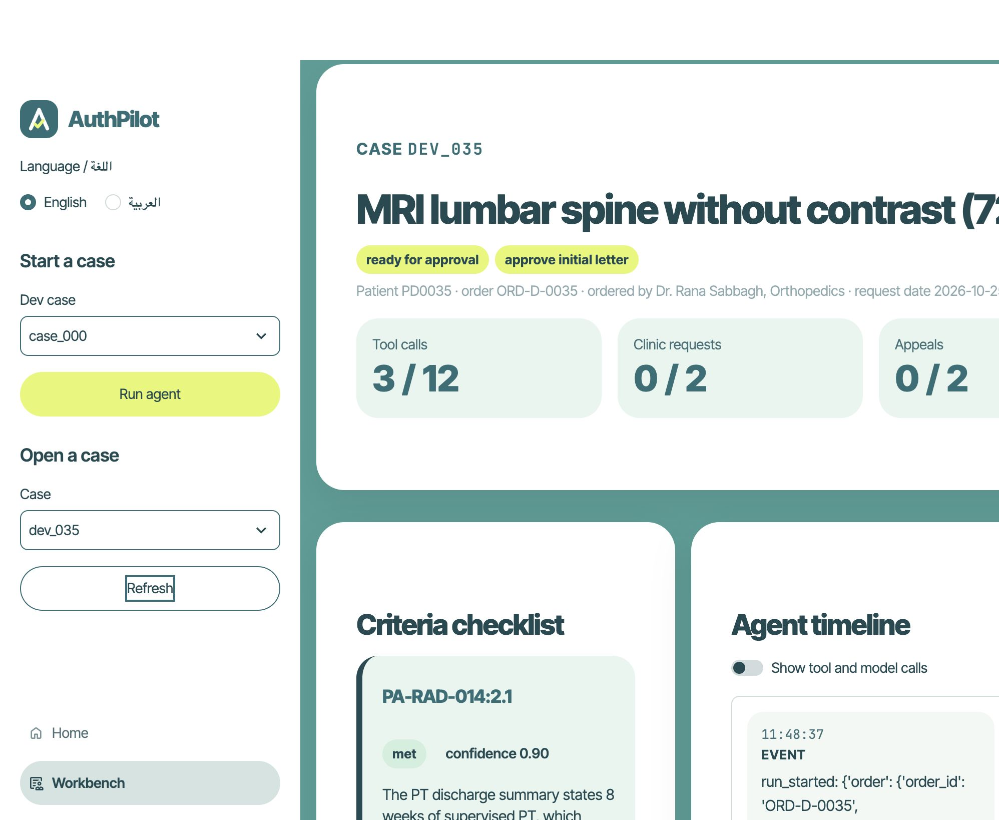
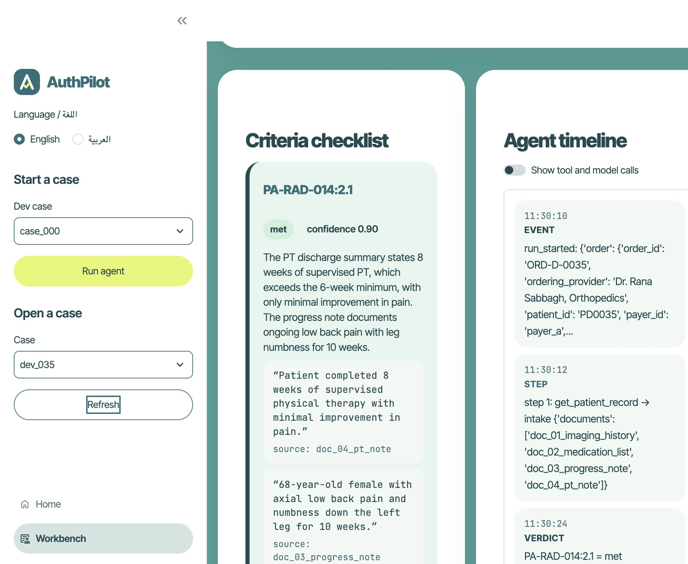
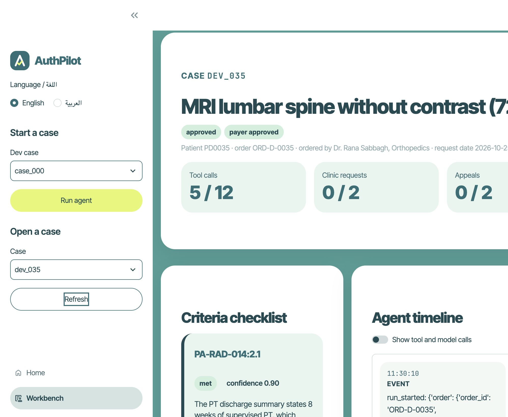
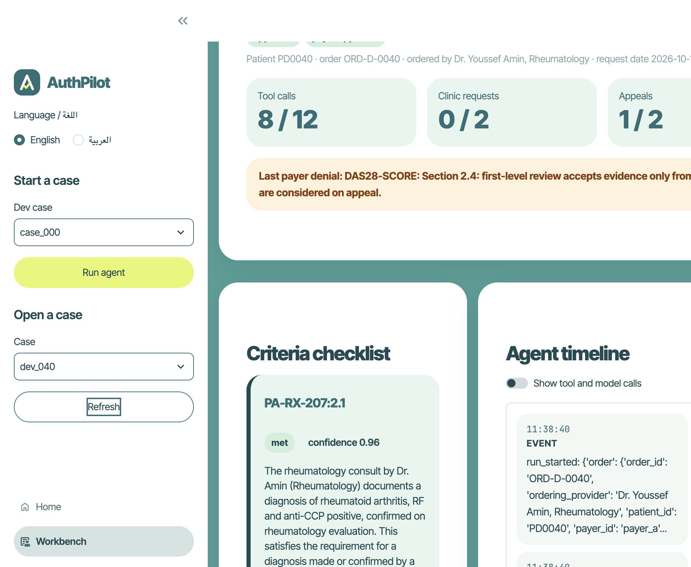
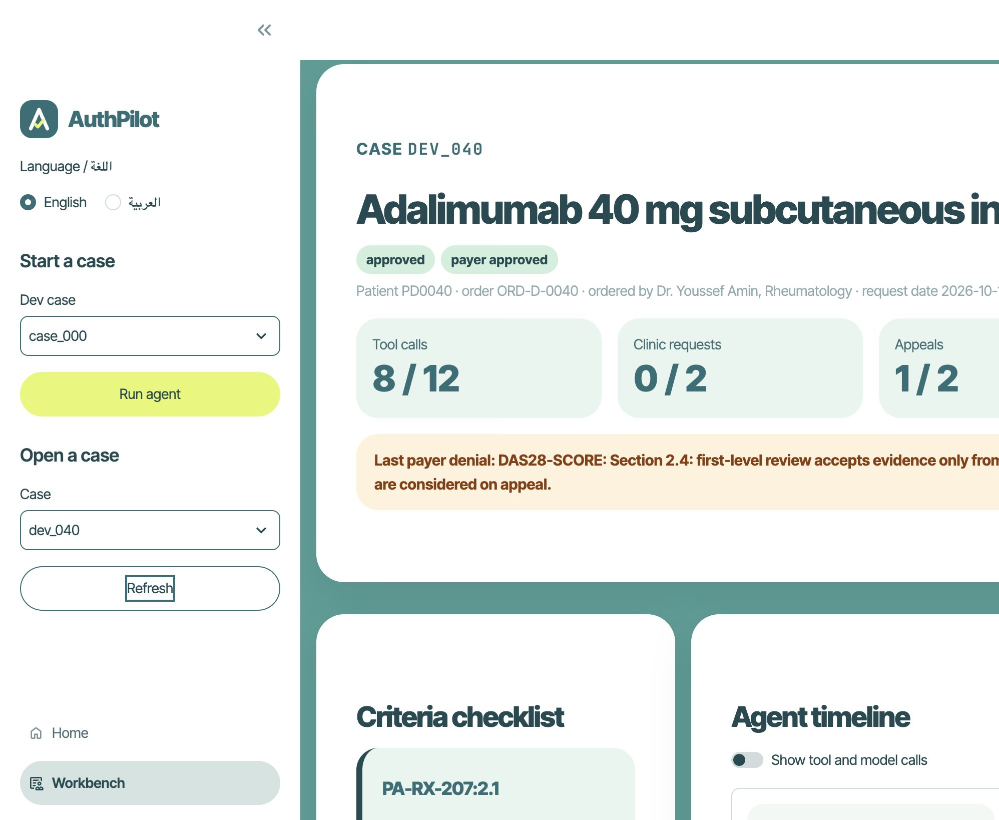
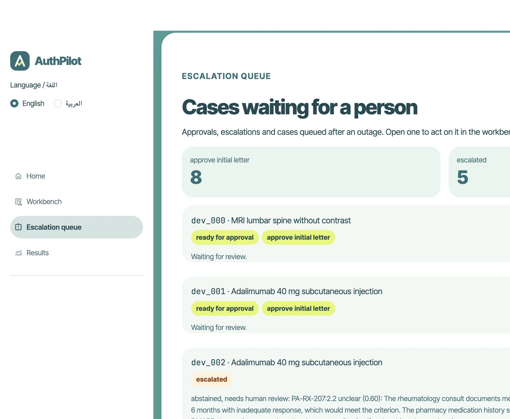
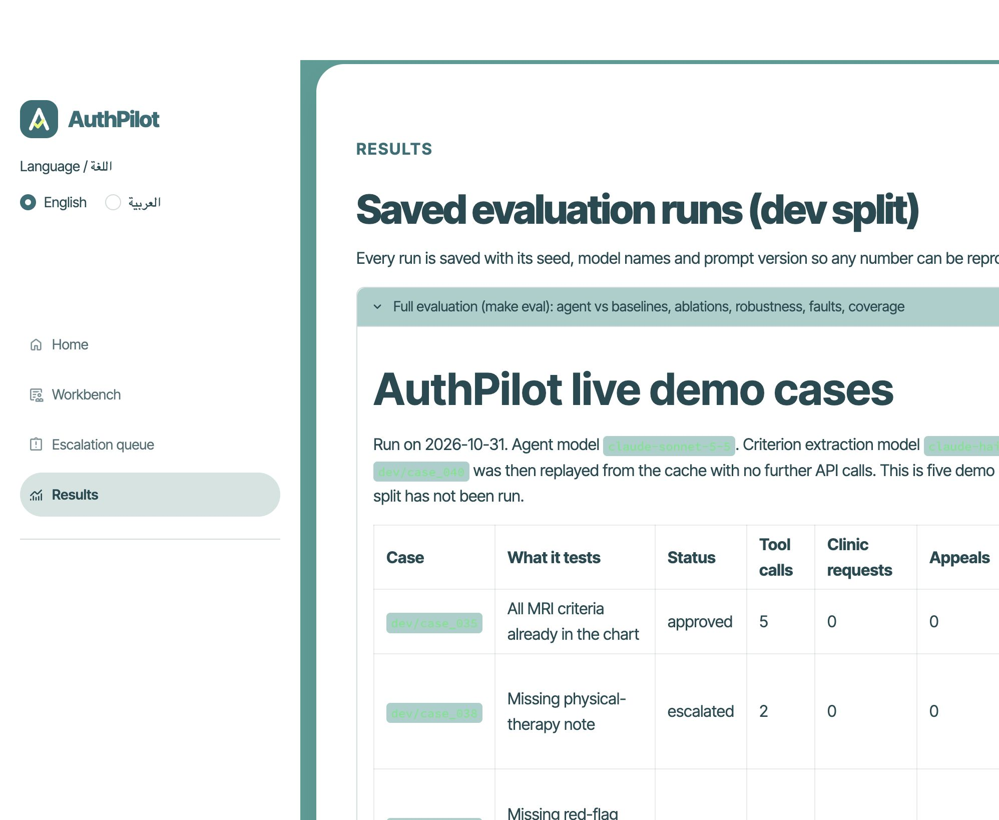
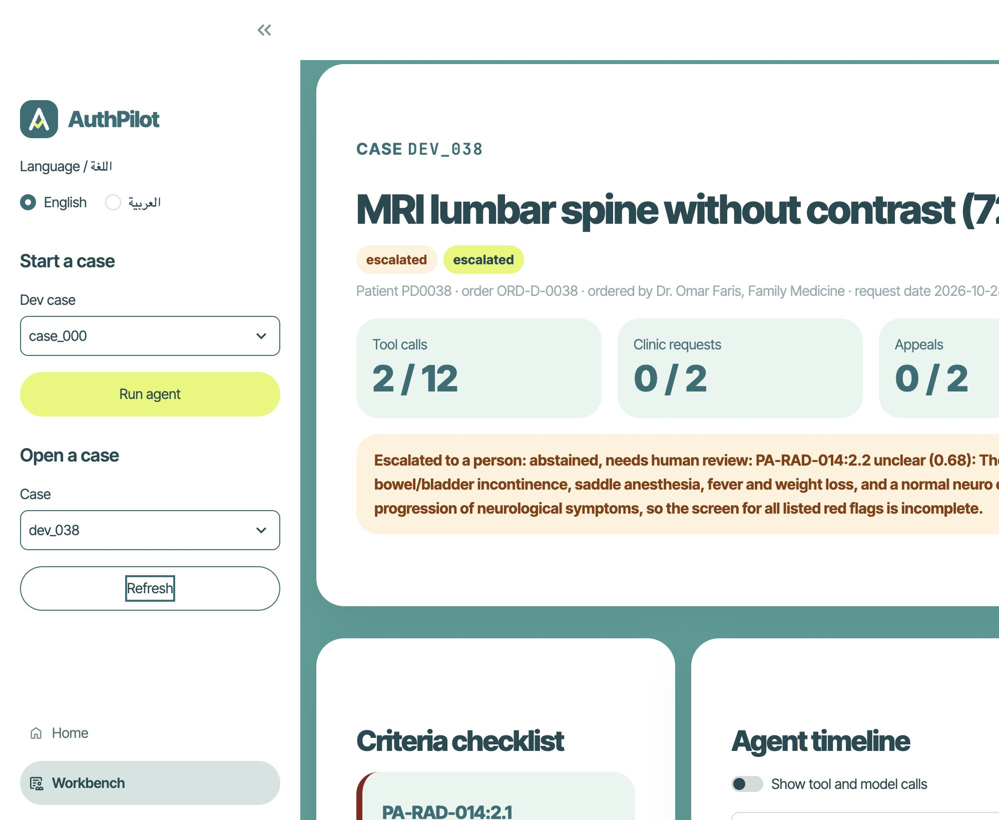
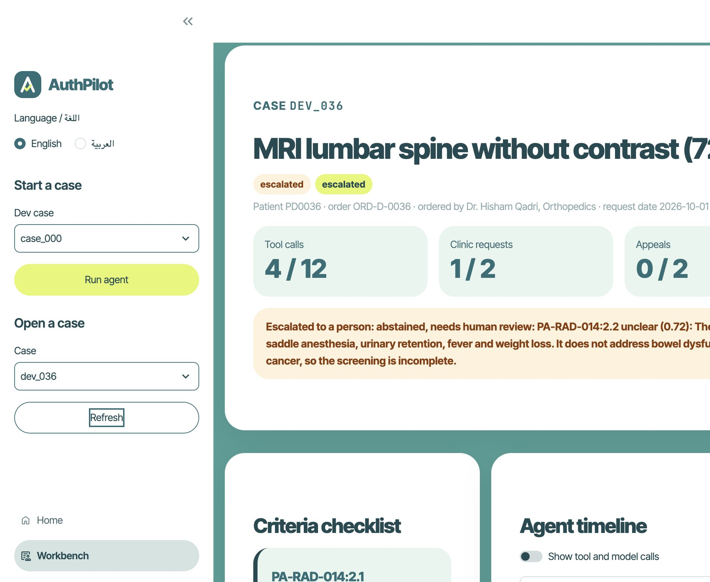

# Demo backup storyboard

Use this if a live run cannot be repeated on stage. Every screenshot was captured from the web app
after the 2026-10-31 Claude runs, replaying the saved responses. The cases are the ones in
[results/eval/latest_dev_live.md](../../results/eval/latest_dev_live.md).

## 1. All criteria met: the agent stops for one human approval

`dev/case_035`, a lumbar MRI. Every criterion is already in the chart. The agent drafts the letter
and waits. Approving binds the reviewer's name to this exact text.

## 2. Evidence for every criterion

Each "met" cites a sentence copied from the chart, with its source document. Code checks that the
quote is really in the chart.

## 3. Approved

After approval, the agent submits and the payer approves. Five tool calls, no clinic request.

## 4. Biologic request: denied, then appealed

`dev/case_040`. The first submission is denied with reason code DAS28-SCORE, because the
disease-activity score is only in a flowsheet. The agent drafts an appeal. One appeal was used,
and the denial stays visible on the case.

## 5. Approved on appeal

The payer approves the appeal. Eight tool calls, one appeal, payer status approved.

## 6. Contradictory records go to the queue

`dev_002` is in the escalation queue. The methotrexate notes disagree, so the agent abstained
instead of choosing one.

## 7. The saved live results

The Results page shows the five live demo cases, not the older stub evaluation.

## 8. A missing note that the live model would not guess past

`dev/case_038` is missing a physical-therapy note. The live model marked red-flag screening
unclear and escalated before asking the clinic. The label expected approval after the clinic
replied. The safety gate abstained.

## 9. Red-flag screening stayed unclear after the clinic replied

`dev/case_036`. The agent asked the clinic (one clinic request) and received the addendum.
Red-flag screening was still unclear, so the case escalated. The label expected approval.

